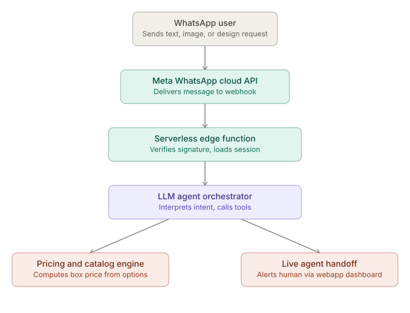

That's the message flow at a glance. Here's the full breakdown.

## 1. Core design decisions

**Channel layer:** WhatsApp Business Platform (Cloud API) via Meta directly, or through a BSP (Twilio, 360dialog, Gupshup, MessageBird). For Africa/Asia/LatAm, going direct to Meta's Cloud API is usually cheapest at scale, but a BSP is worth it early on for faster approval, better local number support, and built-in delivery-status tooling. Either way the integration surface is the same: a webhook that receives inbound messages and a send API for outbound.

**Agent brain:** An LLM (Claude) with tool-calling, not a rigid decision tree. Two tools cover your scope: `get_price(options)` and `handoff_to_human(session_id)`. Everything else — FAQ answering, gathering box specs, collecting the image — is conversation the model handles directly, grounded by a system prompt containing your catalog, pricing rules, and FAQ content (or a retrieval step over them).

**Statefulness is the hard part.** WhatsApp webhooks are stateless HTTP calls; "contextual history" means you own conversation memory yourself, keyed by the user's phone number (`wa_id`).

## 2. Backend components

| Component | Purpose |
|---|---|
| Webhook receiver | Verifies Meta's signature, ack's fast (Meta expects a 200 within ~5–10s), enqueues the real work |
| Message queue | Decouples "received" from "processed" so slow LLM calls don't cause Meta to retry-storm you |
| Session/context store | Rolling conversation history + current order-in-progress state per `wa_id` |
| Agent worker | Calls the LLM with history + system prompt + tools, gets a reply or a tool call |
| Media handler | Downloads user-uploaded images from Meta's media API, stores them, passes a reference (not the raw bytes) to the LLM |
| Pricing engine | Deterministic function/service — box size × material × print complexity × quantity. Keep this out of the LLM; let the LLM call it as a tool so numbers are never hallucinated |
| Handoff service | Flags the session as "needs human," pushes a notification (webhook/websocket) into your existing webapp's dashboard, carries the full chat transcript over |
| Outbound sender | Calls WhatsApp's send-message API, respects the 24-hour session window / template-message rules for anything outside it |

Your existing webapp is the natural home for the human-agent side: same dashboard your team already uses, just add a "WhatsApp conversations" view fed by the handoff service, with the human able to reply back through the same send API.

## 3. Serverless hosting: Cloudflare vs AWS vs GCP

For markets that are mobile-first and often on constrained networks (parts of Africa, South/Southeast Asia, LatAm), the deciding factors are edge latency to those regions, cold-start behavior, and cost per request — not raw compute power, since this workload is I/O-bound (webhook → LLM API call → response), not compute-heavy.

**Cloudflare Workers — generally the best fit here.**
- Runs on V8 isolates at 300+ edge locations, including strong coverage in Africa, South/Southeast Asia, and LatAm — meaningfully lower latency to end users than us-east-1 or a single GCP region.
- No cold starts in the traditional sense (isolates start in ~5ms).
- Pricing is per-request, not per-GB-second-with-idle-provisioning, which tends to be cheaper for spiky, chat-shaped traffic.
- Pairs naturally with **D1** (SQLite, for session/order data), **KV** (fast key-value for conversation history), **R2** (S3-compatible object storage for images, zero egress fees — matters if you're serving/re-fetching images a lot), and **Queues** (for the webhook → worker decoupling).
- Limitation: Workers have execution-time and CPU-time limits (though generous for this workload) and a more constrained runtime than full Node — fine for orchestration logic, less fine if you need heavy image processing in-process.

**AWS Lambda — most mature, most moving parts.**
- Best ecosystem (SQS for queueing, DynamoDB for session store, S3 for media, API Gateway or Lambda Function URLs for the webhook, Step Functions if the flow gets complex).
- Regional, not edge-native — you'd want to pick a region close to your primary market (e.g., `af-south-1` Cape Town, `ap-south-1` Mumbai, `sa-east-1` São Paulo) and accept worse latency for the other two continents, or run multi-region (more cost/complexity).
- Cold starts are a real concern on infrequent conversations unless you pay for provisioned concurrency.
- Makes sense if you're already deep in AWS or need heavier compute (e.g., server-side image manipulation/moderation) in the same function.

**GCP Cloud Functions/Cloud Run — middle ground.**
- Cloud Run in particular is a good option if you want container flexibility (e.g., a Python/Node service with more control than a pure FaaS model) plus decent autoscaling.
- Similarly regional rather than edge-distributed; same latency trade-off as AWS for these markets.
- Firestore works well as a low-latency session store with decent multi-region replication options.

**Recommendation:** Cloudflare Workers + D1/KV + R2 + Queues as the primary stack, with the LLM call and any heavier image processing (moderation, resizing) offloaded to a backend service (could still be a Lambda/Cloud Run function, or your existing webapp's backend) if Workers' runtime limits become a constraint. This gets you the best latency profile for the target markets at the lowest baseline cost, while keeping the option to drop into AWS/GCP for anything compute-heavy.

## 4. Request flow, end to end

1. User messages the WhatsApp number → Meta POSTs to your webhook.
2. Edge function verifies the signature, pushes the raw event onto a queue, returns 200 immediately.
3. A queue consumer (Worker) loads the session from KV/D1, appends the new message (text or image reference) to history.
4. Agent worker calls Claude with: system prompt (catalog + pricing rules + FAQ), conversation history, and the two tools.
5. Model either replies directly (FAQ/pricing question), calls `get_price` (deterministic engine, not the LLM, computes the number), or calls `handoff_to_human` once the user signals they're ready to design/purchase.
6. On handoff, the full transcript + collected specs (images, box dimensions, text, computed price) get pushed to your webapp's dashboard; the WhatsApp thread is marked "human-owned" so the agent stops auto-replying.
7. Outbound reply goes back through WhatsApp's send API.

## 5. A few things worth deciding early

- **Image handling:** Meta gives you a media ID, not the file — you fetch it via their media endpoint, then store it in R2/S3 and pass Claude either the image directly (if within size/context limits) or a description + reference.
- **24-hour session window:** outside it, you can only send pre-approved template messages, not free-form — relevant for any "your design is ready" follow-up.
- **Language:** worth detecting/asking early if you're serving multiple regions — the LLM can handle multilingual conversation natively, but your FAQ/catalog content should be localized too.
- **Handoff trigger:** make it deterministic-feeling — the model should hand off on explicit signals ("I'm ready to order," "connect me to someone") rather than guessing, to avoid premature or missed handoffs.

Want me to go deeper on any one piece — the pricing-engine schema, the Cloudflare Workers project structure, or the webapp-side handoff dashboard?

## 1. Pricing-engine schema

Keep this deterministic and separate from the LLM — the model calls it as a tool, never computes the number itself.

**Data model (D1 / SQL):**

```sql
-- Box product definitions (the catalog)
CREATE TABLE box_types (
  id TEXT PRIMARY KEY,           -- 'small', 'medium', 'large', 'custom-xl'
  name TEXT NOT NULL,
  base_price_cents INTEGER NOT NULL,
  dimensions_cm TEXT,            -- '20x20x10'
  max_print_area_cm2 INTEGER,
  active BOOLEAN DEFAULT 1
);

-- Modifiers: material, finish, print complexity — each adds/multiplies
CREATE TABLE price_modifiers (
  id TEXT PRIMARY KEY,
  category TEXT NOT NULL,        -- 'material' | 'finish' | 'print_complexity' | 'rush'
  option_key TEXT NOT NULL,      -- 'kraft', 'glossy', 'full_color', 'express_48h'
  label TEXT NOT NULL,
  adjustment_type TEXT NOT NULL, -- 'flat_cents' | 'percent'
  adjustment_value INTEGER NOT NULL,
  UNIQUE(category, option_key)
);

-- Quantity breaks
CREATE TABLE quantity_tiers (
  box_type_id TEXT NOT NULL,
  min_qty INTEGER NOT NULL,
  discount_percent INTEGER NOT NULL DEFAULT 0,
  FOREIGN KEY (box_type_id) REFERENCES box_types(id)
);

-- Every quote generated gets logged — both for handoff and for auditing
-- what the agent told a customer
CREATE TABLE quotes (
  id TEXT PRIMARY KEY,
  wa_id TEXT NOT NULL,           -- WhatsApp user id, links to session
  box_type_id TEXT NOT NULL,
  quantity INTEGER NOT NULL,
  selected_modifiers TEXT NOT NULL, -- JSON array of option_keys
  image_refs TEXT,               -- JSON array of R2 object keys
  custom_text TEXT,
  computed_price_cents INTEGER NOT NULL,
  currency TEXT DEFAULT 'USD',
  created_at INTEGER NOT NULL,
  status TEXT DEFAULT 'draft'    -- 'draft' | 'handed_off' | 'confirmed' | 'expired'
);
```

**Tool interface the LLM calls:**

```typescript
// Tool definition passed to Claude
{
  name: "get_price",
  description: "Compute the price for a custom box configuration",
  input_schema: {
    type: "object",
    properties: {
      box_type_id: { type: "string" },
      quantity: { type: "integer", minimum: 1 },
      modifiers: {
        type: "array",
        items: { type: "string" },
        description: "option_keys, e.g. ['kraft','glossy','full_color']"
      }
    },
    required: ["box_type_id", "quantity"]
  }
}
```

**Pricing function (pure, testable, no LLM involved):**

```typescript
async function computePrice(env: Env, input: PriceInput): Promise<PriceResult> {
  const boxType = await env.DB.prepare(
    "SELECT * FROM box_types WHERE id = ? AND active = 1"
  ).bind(input.box_type_id).first();

  if (!boxType) throw new PricingError("unknown_box_type");

  let cents = boxType.base_price_cents;

  for (const key of input.modifiers ?? []) {
    const mod = await env.DB.prepare(
      "SELECT * FROM price_modifiers WHERE option_key = ?"
    ).bind(key).first();
    if (!mod) continue; // unknown modifier — ignore, don't throw mid-conversation
    cents = mod.adjustment_type === "flat_cents"
      ? cents + mod.adjustment_value
      : Math.round(cents * (1 + mod.adjustment_value / 100));
  }

  cents *= input.quantity;

  const tier = await env.DB.prepare(
    `SELECT * FROM quantity_tiers WHERE box_type_id = ? AND min_qty <= ?
     ORDER BY min_qty DESC LIMIT 1`
  ).bind(input.box_type_id, input.quantity).first();
  if (tier) cents = Math.round(cents * (1 - tier.discount_percent / 100));

  return { total_cents: cents, currency: "USD", breakdown: {/* ... */} };
}
```

A few decisions baked into this design:
- **Unknown modifiers are silently ignored, not thrown** — if the LLM passes a slightly wrong key, you want a sane price, not a broken conversation.
- **Every quote is logged**, even ones that never convert — this is what the pricing conversation's context turns into when handed off, and it's useful funnel data later (how many people price a box and never buy).
- **Currency is a column, not hardcoded** — you'll want this per-market fairly quickly given the target regions.

## 2. Cloudflare Workers project structure

```
whatsapp-agent/
├── wrangler.toml
├── package.json
├── src/
│   ├── index.ts                 # Router entry — routes webhook vs internal API
│   ├── webhook/
│   │   ├── verify.ts             # Meta signature verification
│   │   ├── receiver.ts           # POST /webhook — validates, enqueues, 200s fast
│   │   └── types.ts              # WhatsApp payload types
│   ├── queue/
│   │   └── consumer.ts           # Queue consumer — the actual message processing
│   ├── agent/
│   │   ├── orchestrator.ts       # Builds prompt, calls Claude, handles tool_use loop
│   │   ├── system-prompt.ts      # Catalog + FAQ + instructions, templated
│   │   └── tools.ts              # get_price, handoff_to_human tool implementations
│   ├── pricing/
│   │   ├── compute.ts            # computePrice() from above
│   │   └── catalog.ts            # Catalog read/cache helpers
│   ├── media/
│   │   ├── fetch-from-meta.ts    # Downloads media via Meta's media API
│   │   └── store-r2.ts           # Uploads to R2, returns object key
│   ├── session/
│   │   ├── store.ts              # KV read/write for rolling conversation history
│   │   └── types.ts
│   ├── handoff/
│   │   └── notify.ts             # Pushes to webapp dashboard (webhook or DO)
│   ├── whatsapp/
│   │   └── send.ts               # Outbound send-message API wrapper
│   └── db/
│       └── schema.sql            # D1 schema (migrations)
├── test/
└── wrangler.toml
```

**`wrangler.toml` bindings:**

```toml
name = "whatsapp-agent"
main = "src/index.ts"
compatibility_date = "2026-09-01"

[[d1_databases]]
binding = "DB"
database_name = "whatsapp-agent-db"
database_id = "..."

[[kv_namespaces]]
binding = "SESSIONS"
id = "..."

[[r2_buckets]]
binding = "MEDIA"
bucket_name = "whatsapp-agent-media"

[[queues.producers]]
binding = "MESSAGE_QUEUE"
queue = "inbound-messages"

[[queues.consumers]]
queue = "inbound-messages"
max_batch_size = 1
max_retries = 3

[vars]
WHATSAPP_PHONE_NUMBER_ID = "..."

# Secrets set via `wrangler secret put`:
# WHATSAPP_ACCESS_TOKEN, WHATSAPP_APP_SECRET, ANTHROPIC_API_KEY, WEBAPP_HANDOFF_WEBHOOK_SECRET
```

**Why the queue matters:** Meta expects a 200 response quickly and will retry (and eventually disable your webhook) if you're slow. The receiver's only job is: verify signature → `env.MESSAGE_QUEUE.send(payload)` → return 200. All the actual LLM/tool-calling work happens in the queue consumer, decoupled from Meta's timeout expectations. If the LLM call is slow or the model needs a tool round-trip, that's fine — it's not blocking an HTTP response to Meta.

**Session store shape in KV** (fast reads, one entry per `wa_id`):

```typescript
interface Session {
  wa_id: string;
  history: { role: "user" | "assistant"; content: string; timestamp: number }[];
  status: "agent_owned" | "human_owned";
  current_draft_quote?: { box_type_id: string; modifiers: string[]; quantity: number };
  last_active: number;
}
```

Cap `history` (e.g. last ~20 turns, or summarize older turns into a rolling summary field) so the KV value doesn't grow unbounded and the prompt stays within a reasonable token budget.

**The orchestrator's tool loop** is the core agent logic:

```typescript
async function runAgent(env: Env, session: Session, newMessage: string) {
  session.history.push({ role: "user", content: newMessage, timestamp: Date.now() });

  let response = await callClaude(env, session);

  while (response.stop_reason === "tool_use") {
    const toolCall = response.content.find(c => c.type === "tool_use");
    const result = await executeTool(env, session, toolCall);
    session.history.push({ role: "assistant", content: response.content });
    session.history.push({ role: "user", content: [toolResultBlock(toolCall.id, result)] });
    response = await callClaude(env, session);
  }

  session.history.push({ role: "assistant", content: response.content });
  await sendWhatsAppMessage(env, session.wa_id, extractText(response));
  await saveSession(env, session);
}
```

## 3. Webapp-side handoff dashboard

This slots into your existing webapp rather than being a new product. Two things it needs: a data feed of conversations, and a view for the human agent to act on them.

**Data model (in your existing app's DB, or shared with the Worker's D1):**

```sql
CREATE TABLE whatsapp_conversations (
  wa_id TEXT PRIMARY KEY,
  customer_name TEXT,
  status TEXT NOT NULL,          -- 'agent_owned' | 'human_owned' | 'closed'
  assigned_to TEXT,              -- staff user id, once claimed
  last_message_at INTEGER,
  handed_off_at INTEGER,
  created_at INTEGER
);

CREATE TABLE whatsapp_messages (
  id TEXT PRIMARY KEY,
  wa_id TEXT NOT NULL,
  sender TEXT NOT NULL,          -- 'customer' | 'agent_bot' | 'human:{staff_id}'
  content TEXT,
  media_url TEXT,                -- R2 signed URL if it's an image
  created_at INTEGER,
  FOREIGN KEY (wa_id) REFERENCES whatsapp_conversations(wa_id)
);
```

The `quotes` table from the pricing engine is joined in by `wa_id` — so when a conversation opens in the dashboard, the agent sees not just the transcript but the exact box configuration and price already discussed, no re-asking the customer.

**Handoff flow:**

1. `handoff_to_human` tool fires in the Worker → it writes `status = 'human_owned'` on the conversation, POSTs to a webhook endpoint on your webapp with `{ wa_id, reason, latest_quote_id }`.
2. Webapp receives it, creates/updates the conversation row, and — this is the "live" part — pushes a real-time update to any connected dashboard clients (WebSocket, Server-Sent Events, or if your stack already has one, Pusher/Ably/Supabase Realtime).
3. Dashboard shows an "unclaimed handoffs" queue. A staff member claims it (`assigned_to = me`), which flips `status` and stops the bot from auto-replying to that `wa_id` — the Worker checks this status before running the agent on any new inbound message.
4. Staff replies from the dashboard UI → your webapp calls the same WhatsApp send API (either directly, or by calling back into the Worker's `send.ts`) → message goes out, gets logged to `whatsapp_messages`.
5. Staff can hand back to the bot ("close and return to automation") which flips `status` back to `agent_owned`.

**Dashboard UI, concretely — three panels:**
- **Queue list** (left): unclaimed + assigned conversations, sorted by `last_message_at`, unclaimed ones visually flagged.
- **Transcript view** (center): full message history, customer images rendered inline, the current quote pinned at the top (box type, options, price) so the agent doesn't scroll to find it.
- **Composer** (bottom): plain reply box, plus quick actions — "send price confirmation," "mark as ordered," "return to bot."

**One design point worth being deliberate about:** decide whether "human_owned" is per-conversation or time-boxed. A common failure mode is a conversation getting permanently stuck on a human after handoff even for unrelated future messages weeks later. Simplest fix: auto-expire `human_owned` back to `agent_owned` after N hours of inactivity, or explicitly when staff clicks "close."

Want me to write any of this out as actual working code (the Worker project scaffolded, or the D1 migration files) rather than illustrative snippets?

